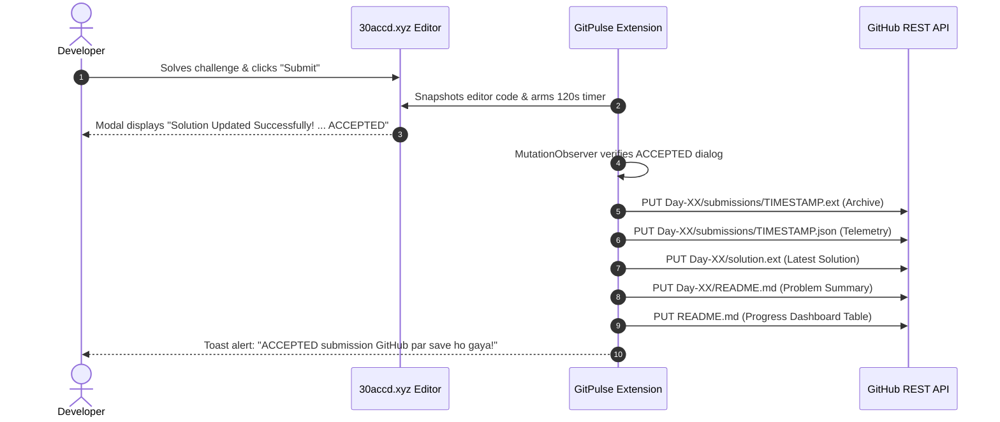

# GitPulse ⚡

<p align="center">
  <strong>Automated, Zero-Friction Coding Challenge Archival directly to GitHub.</strong>
</p>

<p align="center">
  <a href="https://github.com/zain-cmd-hub/GitPulse/releases"></a>
  <a href="manifest.json"></a>
  <a href="LICENSE"></a>
  <a href="https://api.github.com"></a>
  <a href="https://30accd.xyz"></a>
  <a href="https://github.com/zain-cmd-hub"></a>
</p>

<p align="center">
  <a href="https://github.com/zain-cmd-hub/GitPulse/archive/refs/heads/main.zip">
    
  </a>
  <a href="GitPulse-v1.0.0.zip">
    
  </a>
</p>

<p align="center">
  <a href="#key-features">Key Features</a> •
  <a href="#how-it-works">How It Works</a> •
  <a href="#installation-guide">Installation</a> •
  <a href="#configuration">Configuration</a> •
  <a href="#repository-structure">Repo Structure</a> •
  <a href="#architecture">Architecture</a> •
  <a href="#security--privacy">Security</a> •
  <a href="#documentation">Docs</a> •
  <a href="#author--credits">Author</a>
</p>

---

## Direct Download

You can download GitPulse directly using either option below:

| Download Type | Link | Description |
| :--- | :--- | :--- |
| **🚀 Direct GitHub ZIP** | [**Download Latest ZIP (GitHub)**](https://github.com/zain-cmd-hub/GitPulse/archive/refs/heads/main.zip) | Instant download of the latest repository source ZIP from GitHub. |
| **📦 Pre-Packaged Offline ZIP** | [**Download GitPulse-v1.0.0.zip**](GitPulse-v1.0.0.zip) | Complete offline distribution archive containing all extension assets. |

---

## Introduction

**GitPulse** is a lightweight, high-reliability Google Chrome extension built on **Manifest V3** by **Mohammad Abbas** that automatically captures verified, accepted coding challenge solutions and pushes them directly to your designated GitHub repository.

No manual copying, no tab switching, and no risk of losing your daily coding streak. As soon as your solution receives an **ACCEPTED** verdict on the platform, GitPulse securely packages your source code, generates rich execution metadata, archives the historical attempt, updates the canonical solution, and maintains a clean 30-day progress dashboard in your repository.

> :information_source: **Platform Compatibility Notice**:
> The v1.0.0 implementation specifically targets coding challenges hosted on **[30accd.xyz/dashboard](https://30accd.xyz/dashboard)** (e.g. the 30 Days of Code challenge). GitPulse is architected for future multi-platform expansion, but **does not** currently support LeetCode, HackerRank, or CodeChef in this release.

---

## Key Features

- :dart: **State-Gated Acceptance Capture**: Arms a 120-second verification window only when you click **Submit** or **Update Solution**. Rejects failed test runs, syntax errors, and local test-only runs ("Run Code").
- :mag: **Deep Multi-Engine Editor Inspection**: Inspects the browser's JavaScript runtime memory to read editor buffers directly from **Monaco Editor** (`window.monaco`), **CodeMirror 5**, **CodeMirror 6**, and **Ace Editor** (`window.ace`), with configurable fallback for raw DOM textareas.
- :globe_with_meridians: **Multi-Language Normalization**: Automatically identifies and categorizes 9 programming languages:
  - **JavaScript** (`.js`), **TypeScript** (`.ts`), **Python** (`.py`), **C++** (`.cpp`), **C** (`.c`), **C#** (`.cs`), **Go** (`.go`), **Java** (`.java`), and **Rust** (`.rs`).
- :shield: **Zero-Leak Credential Security**: Your GitHub Personal Access Token (PAT) is stored with `accessLevel: 'TRUSTED_CONTEXTS'`. Tokens are quarantined inside the extension background service worker and **never** exposed to page scripts, DOM elements, or web requests.
- :file_folder: **Dual-Tier Archival Strategy**:
  1. **Historical Attempt Archive**: Timestamped immutable snapshot (`Day-XX/submissions/<timestamp>-<id>.<ext>`) with telemetry JSON.
  2. **Canonical Latest Solution**: Clean, unversioned latest source file (`Day-XX/solution.<ext>`).
- :bar_chart: **Automated Progress Dashboard**: Dynamically generates and updates a 30-day challenge tracking table in your repository's root `README.md` using safe, non-destructive HTML comment markers.
- :stethoscope: **In-Browser Diagnostic Suite**: The GitPulse popup includes a one-click diagnostics tool that inspects the active challenge DOM and lets you export sanitized diagnostic reports for troubleshooting.

---

## How It Works



---

## Technology Stack

- **Extension Framework**: Google Chrome Extensions **Manifest V3**
- **Runtime**: Vanilla JavaScript (ES2022+ modules, no bundler overhead)
- **API Protocol**: GitHub REST API (`https://api.github.com`, version `2022-11-28`)
- **Storage Subsystem**: Chrome Extension Storage API (`chrome.storage.local` with `TRUSTED_CONTEXTS`)
- **DOM Engine**: W3C `MutationObserver` API and `window.postMessage` inter-world bridge
- **Testing Engine**: Node.js strict assertion suite (`node:assert/strict`)

---

## Project Folder Structure

```text
GitPulse/
├── manifest.json              # Chrome Extension Manifest V3 configuration
├── package.json               # Project metadata and test scripts
├── LICENSE                    # MIT Open-Source License (Mohammad Abbas)
├── README.md                  # Main documentation portal with direct download
├── CONTRIBUTING.md            # Contribution guidelines & development setup
├── SECURITY.md                # Security policy, credential model & disclosure
├── CHANGELOG.md               # Version release notes and change history
├── .gitignore                 # Standard repository exclusion rules
├── GitPulse-v1.0.0.zip        # Pre-packaged offline distribution archive
│
├── background/
│   └── service-worker.js      # Background ES worker: GitHub API & storage
│
├── content/
│   ├── content.js             # ISOLATED world: DOM events & MutationObserver
│   └── page-bridge.js         # MAIN world: In-memory editor & model inspection
│
├── popup/
│   ├── popup.html             # Extension popup UI & diagnostic view
│   ├── popup.js               # Popup interactions, verification & clipboard
│   └── popup.css              # Dark-mode styling for popup panel
│
├── options/
│   ├── options.html           # Settings UI for GitHub credentials & adapter
│   ├── options.js             # Settings persistence & token validation
│   └── options.css            # Dark-mode styling for settings page
│
├── icons/
│   ├── icon16.png             # 16x16 extension toolbar icon
│   ├── icon32.png             # 32x32 desktop icon
│   ├── icon48.png             # 48x48 extension manager icon
│   └── icon128.png            # 128x128 store & installation graphic
│
├── docs/
│   ├── INSTALLATION.md        # Step-by-step setup guide for beginners
│   ├── CONFIGURATION.md       # GitHub repo & fine-grained PAT creation guide
│   ├── USAGE.md               # End-to-end user manual & workflow
│   ├── ARCHITECTURE.md        # Deep-dive technical architecture & diagrams
│   └── TROUBLESHOOTING.md     # Diagnostic triage matrix & resolution guide
│
├── tests/
│   ├── smoke-test.js          # Unit tests for language, parsing & markers
│   └── verify-links.js        # Automated documentation link integrity suite
│
└── .github/
    ├── workflows/ci.yml       # GitHub Actions CI workflow (Node 18/20/22)
    └── ISSUE_TEMPLATE/        # Structured issue templates
        ├── bug_report.yml     # Bug report template
        └── feature_request.yml# Feature & adapter proposal template
```

---

## Installation Requirements

- **Browser**: Google Chrome 88+, Brave, Microsoft Edge, Opera, or Arc.
- **Account**: Active GitHub account with repository creation permissions.
- **Node.js**: v18.0+ (optional, only required if running local unit tests).

---

## Visual Step-by-Step Installation & Setup Guide

GitPulse is ready to use in less than 3 minutes. Follow this visual walkthrough:

### Step 1: Open Chrome Extensions & Enable Developer Mode
1. Open Google Chrome and type `chrome://extensions/` in the address bar.
2. In the top-right corner, toggle **Developer mode** to **ON** (blue).

```text
┌────────────────────────────────────────────────────────────────────────┐
│ Extensions                                          Developer mode [●] │
├────────────────────────────────────────────────────────────────────────┤
│ [Load unpacked]  [Pack extension]  [Update]                            │
└────────────────────────────────────────────────────────────────────────┘
```

### Step 2: Load the GitPulse Folder
1. Click **Load unpacked** in the top-left toolbar.
2. Select the extracted `GitPulse` root folder (containing `manifest.json`).
3. The **GitPulse** extension card will appear immediately:

```text
┌────────────────────────────────────────────────────────────────────────┐
│ ┌────────────────────────────────────────────────────────────────────┐ │
│ │ [GP] GitPulse 1.0.0                                       [Details]│ │
│ │ Capture verified accepted 30ACC coding submissions and archive...  │ │
│ │ ID: your-extension-id-here                                         │ │
│ │ Inspect views: service worker (active)                             │ │
│ │                                                         [🔄]  [●]  │ │
│ └────────────────────────────────────────────────────────────────────┘ │
└────────────────────────────────────────────────────────────────────────┘
```

### Step 3: Pin GitPulse to Your Toolbar
Click Chrome's Extensions puzzle icon (🧩) and click the **Pin** icon (📌) next to GitPulse:

```text
Chrome Toolbar:
┌──────────────────────────────────────────────────────────────┐
│  [ < ] [ > ] [ 🔄 ]  [ https://30accd.xyz/dashboard ]    [GP] [🧩] [👤]│
└──────────────────────────────────────────────────────────────┘
                                                             ▲
                                                    Pinned GitPulse Icon
```

### Step 4: Generate a GitHub Personal Access Token (PAT)
1. Go to [GitHub Token Settings (Beta)](https://github.com/settings/tokens?type=beta).
2. Click **Generate new token**.
3. Under **Repository access**, choose **Only select repositories** and pick your target repository.
4. Under **Repository permissions**, set **Contents** to **Read and write**.
5. Click **Generate token** and copy the token (`github_pat_11A...`).

```text
GitHub Token Creation Interface:
┌────────────────────────────────────────────────────────────────────────┐
│ Token name:    [ GitPulse-Sync                                       ] │
│ Expiration:    [ 90 days                                           ▼ ] │
│                                                                        │
│ Repository access:                                                     │
│ ( ) All repositories                                                   │
│ (●) Only select repositories                                           │
│     [ Select repositories: 30-Days-of-Code-2026---ACC              ▼ ] │
│                                                                        │
│ Repository permissions:                                                │
│ ┌────────────────────────────────────────────────────────────────────┐ │
│ │ Contents         Access: [ Read and write                        ▼]│ │
│ │ (Metadata is automatically set to Read-only)                       │ │
│ └────────────────────────────────────────────────────────────────────┘ │
│                                                                        │
│ [ Generate token ]                                                     │
└────────────────────────────────────────────────────────────────────────┘
```

### Step 5: Configure Settings & Verify Connection
1. Click the GitPulse **GP** icon in your toolbar → click **Settings**.
2. Enter your GitHub username (e.g. `zain-cmd-hub`), target repository name (`30-Days-of-Code-2026---ACC`), and paste your token.
3. Click **Save settings**, then click **Verify GitHub access**.

```text
GitPulse Settings Screen:
┌────────────────────────────────────────────────────────────────────────┐
│ GitPulse Settings                                                      │
│ Connect one GitHub repository. Token is kept in secure local storage.  │
│                                                                        │
│ GitHub owner / username                                                │
│ [ zain-cmd-hub                                                       ] │
│                                                                        │
│ Repository name                                                        │
│ [ 30-Days-of-Code-2026---ACC                                         ] │
│                                                                        │
│ Fine-grained GitHub token                                              │
│ [ •••••••••••••••••••••••••••••••••••••••••••••••••••••••••••••••••• ] │
│ Token saved securely in extension storage.                             │
│                                                                        │
│ [✓] Enable automatic upload after verified ACCEPTED result             │
│                                                                        │
│ [ Save settings ]   [ Verify GitHub access ]   [ Remove saved token ]  │
│                                                                        │
│ Status: Connected: zain-cmd-hub/30-Days-of-Code-2026---ACC (push ok)   │
└────────────────────────────────────────────────────────────────────────┘
```

### Step 6: Solve Challenges with Live Diagnostics & Feedback
1. Navigate to any problem on [30accd.xyz/dashboard](https://30accd.xyz/dashboard).
2. Open GitPulse and click **Run diagnostics** to inspect active editor detection:

```text
┌──────────────────────────────────────────────┐
│  [GP] GitPulse                               │
│  Current page diagnostics                    │
│  Contains Duplicate II                       │
│  ------------------------------------------  │
│  Day: 6                                      │
│  Editor: monaco                              │
│  Language: javascript                        │
│  Code length: 245                            │
│  Submit button: Detected                     │
│                                              │
│  [ Run diagnostics ]   [ Copy report ]       │
└──────────────────────────────────────────────┘
```

3. Write your code and click **Submit Solution**.
4. GitPulse displays live on-screen toast alerts on the webpage:
   - On click: `⚡ Submission attempt detected. ACCEPTED result ka wait ho raha hai…`
   - On pass: `⚡ ACCEPTED submission GitHub par save ho gaya!`
5. Your solution code, metadata, and 30-day tracking dashboard are instantly synced to your GitHub repository!

---

For additional details, see our in-depth guides:
- 📖 [Full Installation Guide](docs/INSTALLATION.md)
- ⚙️ [Full Configuration Guide](docs/CONFIGURATION.md)
- 🚀 [Full Usage Guide](docs/USAGE.md)

---

## Example Uploaded Solution Structure

When GitPulse synchronizes an accepted solution, it constructs the following structure in your repository:

```text
30-Days-of-Code-2026---ACC/
├── README.md
└── Day-06/
    ├── solution.js
    ├── README.md
    └── submissions/
        ├── 2026-11-08T08-15-22-123Z-a1b2c3d4.js
        └── 2026-11-08T08-15-22-123Z-a1b2c3d4.json
```

### Sample Submission Metadata (`Day-06/submissions/TIMESTAMP.json`)

```json
{
  "submission_id": "9b1deb4d-3b7d-4bad-9bdd-2b0d7b3dcb6d",
  "day": 6,
  "challenge_id": "dsa-day-06-contains-duplicate-ii",
  "challenge_title": "Contains Duplicate II",
  "difficulty": "easy",
  "language": "javascript",
  "status": "ACCEPTED",
  "passed_test_cases": 1,
  "total_test_cases": 1,
  "pass_percentage": 100,
  "runtime": null,
  "memory": null,
  "submitted_at": "2026-11-08T08:15:22.123Z",
  "source_url": "https://30accd.xyz/dashboard/dsa-day-06-contains-duplicate-ii",
  "source_file": "solution.js",
  "editor_type": "monaco",
  "editor_confidence": "api"
}
```

### Sample Progress Dashboard Table (in Root `README.md`)

```markdown
<!-- 30ACC-LEETHUB:START -->
## 30 Days of Code — Progress Dashboard

Latest accepted submission: **Contains Duplicate II** (Day 06) · 2026-11-08T08:15:22.123Z

| Day | Details | Challenge | Difficulty | Language | Status |
|:---:|:---|:---|:---:|:---:|:---:|
| 01 | [Day 01](./Day-01/README.md) | Two Sum | easy | python | ACCEPTED |
| 02 | [Day 02](./Day-02/README.md) | Best Time to Buy and Sell Stock | easy | cpp | ACCEPTED |
| 06 | [Day 06](./Day-06/README.md) | Contains Duplicate II | easy | javascript | ACCEPTED |
| 07 | — | — | — | — | — |
<!-- 30ACC-LEETHUB:END -->
```

---

## Security and Privacy

GitPulse is engineered with a strict security boundary:

- **Isolated Storage**: GitPulse uses Chrome's `TRUSTED_CONTEXTS` storage access level. Content scripts and third-party scripts on the webpage cannot read your GitHub token.
- **Least-Privilege Token**: GitPulse only requires `Contents: Read and write` on your specific repository. Never grant account-wide admin permissions.
- **Sanitized Diagnostic Output**: When copying diagnostic logs to your clipboard, all source code and tokens are excluded.
- **Honest Platform Limitation**: Extension storage is stored unencrypted inside your local Chrome user profile directory on your disk. Do not share your workstation user profile.

For detailed security policies and disclosure procedures, see [SECURITY.md](SECURITY.md).

---

## Current Platform Compatibility

| Feature / Platform | Support Status | Notes |
| :--- | :---: | :--- |
| **30accd.xyz /dashboard** | :white_check_mark: **Supported** | Full editor inspection, acceptance detection & archival |
| **Monaco Editor** | :white_check_mark: **Supported** | In-memory model value extraction via `page-bridge.js` |
| **CodeMirror 5 & 6** | :white_check_mark: **Supported** | Automatic view discovery and doc extraction |
| **Ace Editor** | :white_check_mark: **Supported** | `window.ace.edit` session mode and value extraction |
| **Plain Textarea / ContentEditable** | :white_check_mark: **Supported** | Fallback mode (configurable in Settings) |
| **LeetCode** | :construction: *Planned* | Planned for future release |
| **HackerRank** | :construction: *Planned* | Planned for future release |
| **CodeChef / Codeforces** | :construction: *Planned* | Planned for future release |

---

## Troubleshooting & FAQ

### Frequently Asked Questions

**Q: Does GitPulse upload failed submissions or "Run Code" attempts?**  
*A: No. GitPulse requires an explicit submission button click followed within 120 seconds by a verified modal containing both "Solution Updated Successfully!" and "ACCEPTED". Failed attempts and sample runs are completely ignored.*

**Q: Does GitPulse overwrite my custom notes in `README.md`?**  
*A: No. GitPulse updates only the content enclosed between the comment tags `<!-- 30ACC-LEETHUB:START -->` and `<!-- 30ACC-LEETHUB:END -->`. Everything else in your README is preserved.*

**Q: Why are Runtime (ms) and Memory (MB) null in my metadata JSON?**  
*A: The 30accd.xyz success dialog currently reports test pass status (e.g. `1/1 Passed`) but does not output runtime execution time or memory usage stats.*

For answers to other common questions, review our [Troubleshooting Guide](docs/TROUBLESHOOTING.md).

---

## Documentation Index

Explore our comprehensive documentation suite:

- :book: **[Installation Guide](docs/INSTALLATION.md)** — Step-by-step setup for beginners.
- :gear: **[Configuration Guide](docs/CONFIGURATION.md)** — Setting up GitHub repositories and fine-grained PATs.
- :rocket: **[Usage Guide](docs/USAGE.md)** — Complete workflow, submissions, and toast notifications.
- :triangular_ruler: **[Architecture Guide](docs/ARCHITECTURE.md)** — Manifest V3 design, state machine, and Mermaid diagrams.
- :wrench: **[Troubleshooting Guide](docs/TROUBLESHOOTING.md)** — Diagnostic triage matrix and error solutions.
- :handshake: **[Contributing Guidelines](CONTRIBUTING.md)** — How to test, contribute, and submit pull requests.
- :lock: **[Security Policy](SECURITY.md)** — Threat model, permissions rationale, and responsible disclosure.
- :memo: **[Changelog](CHANGELOG.md)** — Version release notes and migration history.

---

## Roadmap

- [x] Manifest V3 architecture with isolated page bridge.
- [x] 30accd.xyz dashboard challenge adapter.
- [x] Multi-engine editor support (Monaco, CodeMirror 5/6, Ace).
- [x] Dual-tier commit model (archive + latest solution + dashboard).
- [x] In-browser diagnostic panel with clipboard export.
- [ ] LeetCode platform adapter.
- [ ] HackerRank platform adapter.
- [ ] Custom commit message formatting templates.
- [ ] Target branch selection (e.g., `main`, `master`, `solutions`).

---

## Author & Credits

**GitPulse** is designed, created, and maintained by:

### **Mohammad Abbas**
- **GitHub Profile**: [@zain-cmd-hub](https://github.com/zain-cmd-hub)
- **Project Repository**: [https://github.com/zain-cmd-hub/GitPulse](https://github.com/zain-cmd-hub/GitPulse)
- **Role**: Creator & Lead Maintainer
- **Copyright**: © 2026 Mohammad Abbas. All rights reserved under the MIT License.

---

## License

This project is licensed under the **MIT License** — authored by **Mohammad Abbas**. See the [LICENSE](LICENSE) file for the full legal text.
