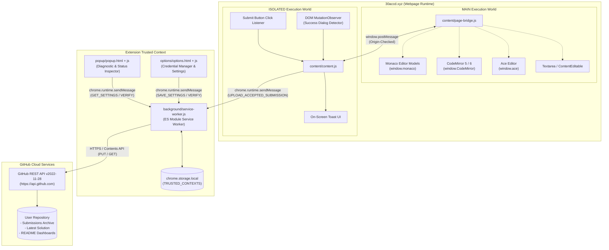
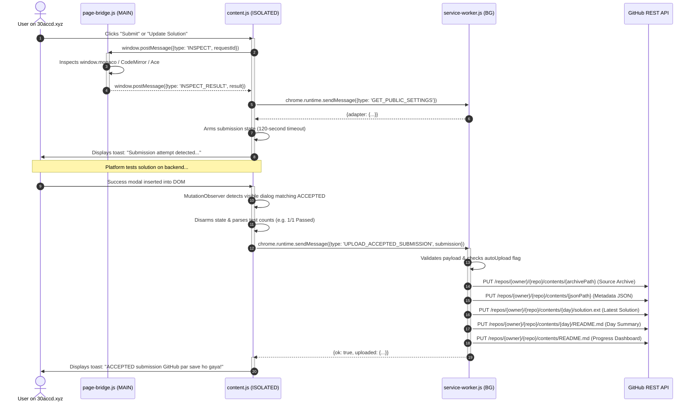
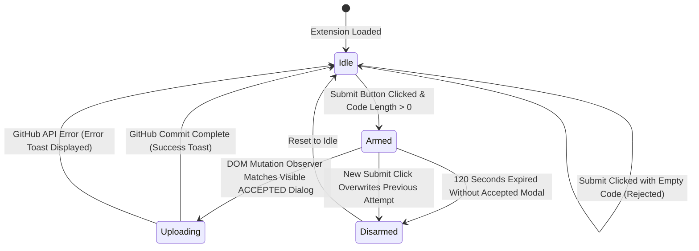
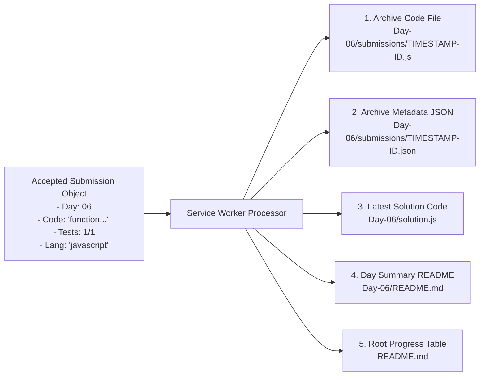

# GitPulse Technical Architecture

This document provides an in-depth breakdown of the internal architecture, component boundaries, message communication protocols, and execution workflows of **GitPulse**.

---

## High-Level System Architecture

GitPulse is built strictly upon the **Google Chrome Manifest V3** specification, enforcing clean separation of privileges, asynchronous service-worker lifecycle, and secure credential handling.



---

## Execution Environments & Component Roles

### 1. Page Bridge (`content/page-bridge.js`)
- **Execution World**: `MAIN` (Direct in-page execution context).
- **Security Boundary**: Strictly isolated from extension storage and GitHub tokens.
- **Responsibilities**:
  - Direct access to JavaScript runtime global objects (`window.monaco`, `window.CodeMirror`, `window.ace`).
  - Extracting code directly from memory buffers (e.g., `model.getValue()`) rather than relying on brittle HTML text scraping.
  - Analyzing editor languages via Monaco language IDs or language selector dropdowns.
  - Responding to `INSPECT` requests from the isolated content script via window postMessage.

### 2. Isolated Content Script (`content/content.js`)
- **Execution World**: `ISOLATED` (Browser-managed content script context).
- **Responsibilities**:
  - Listening for user click events on challenge submission buttons (`Submit`, `Submit Solution`, `Update Solution`).
  - Enforcing a 1.5-second debounce window to prevent rapid duplicate event triggers.
  - Managing the **Armed Submission State** (120-second validity window).
  - Monitoring DOM mutations via `MutationObserver` targeting newly inserted visible modal dialogs matching both `Solution Updated Successfully!` and `ACCEPTED (n/n Passed)`.
  - Rendering non-intrusive on-screen toast feedback (`__30acc_leethub_toast`).
  - Forwarding accepted submission packages to the background service worker.

### 3. Background Service Worker (`background/service-worker.js`)
- **Execution World**: Service Worker (Extension background context).
- **Responsibilities**:
  - Securing storage with `chrome.storage.local.setAccessLevel({ accessLevel: 'TRUSTED_CONTEXTS' })`.
  - Storing and retrieving GitHub configuration (owner, repo, PAT, auto-upload toggle, custom adapter rules).
  - Validating GitHub credentials and write permissions (`permissions.push`).
  - Orchestrating the multi-file commit sequence via the GitHub REST API.
  - Merging automated tables into repository READMEs without destroying user-written content.

### 4. Extension UI (`popup/` & `options/`)
- **Popup (`popup/popup.html`)**: Real-time diagnostic tool querying the active tab to inspect editor models, extracted code length, and target button status.
- **Options (`options/options.html`)**: Dedicated credential management UI allowing users to configure repository parameters and test connectivity.

---

## Inter-Component Message Protocol



---

## Submission Detection State Machine



---

## GitHub Archival & File Generation Workflow

When an accepted submission is processed, GitPulse executes five coordinated API calls against the GitHub REST API:



### Managed Markdown Block Algorithm
To avoid overwriting custom documentation created by the user, GitPulse isolates its automated markdown summaries between distinctive HTML comment boundaries:

```html
<!-- 30ACC-LEETHUB:START -->
... Managed Content Auto-Generated by GitPulse ...
<!-- 30ACC-LEETHUB:END -->
```

- When updating `README.md`, GitPulse reads the existing file from GitHub.
- If the markers exist, only the text enclosed between the markers is replaced.
- Any notes, header banners, or custom links written outside the markers remain untouched.

---

## Data Schema: Submission Object

The internal JSON object dispatched from `content.js` to `service-worker.js` conforms to the following schema:

```json
{
  "submissionId": "UUID string (crypto.randomUUID)",
  "day": 6,
  "slug": "dsa-day-06-contains-duplicate-ii",
  "title": "Contains Duplicate II",
  "difficulty": "easy",
  "url": "https://30accd.xyz/dashboard/dsa-day-06-contains-duplicate-ii",
  "pageTitle": "30 Days of Code",
  "language": "javascript",
  "editorType": "monaco",
  "editorConfidence": "api",
  "code": "/* source code */",
  "status": "ACCEPTED",
  "passedTestCases": 1,
  "totalTestCases": 1,
  "passPercentage": 100,
  "submittedAt": "2026-11-08T08:15:22.123Z",
  "runtime": null,
  "memory": null,
  "elapsedTime": null,
  "successEvidence": "fresh post-click success dialog text"
}
```

